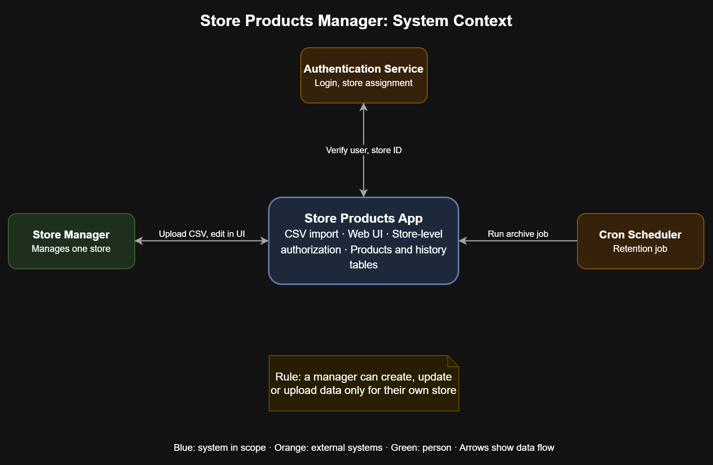
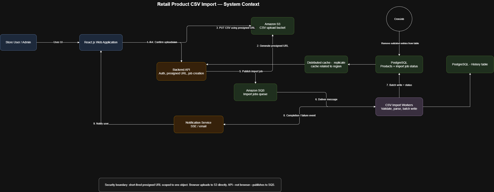

# Retail Product CSV Import

A system that lets store users upload product pricing data as CSV files, processes large files asynchronously, and keeps the main products table fast by archiving old entries. It is an internal application for store users and admins.

## Contents

- [Overview](#overview)
- [Architecture](#architecture)
- [Import flow](#import-flow)
- [Design decisions](#design-decisions)
- [Non-functional requirements](#non-functional-requirements)
- [Assumptions](#assumptions)
- [Future improvements](#future-improvements)
- [How to run](#how-to-run)

## Overview

**What it does**

- A store manager uploads a CSV of product data, or edits existing products through the web UI.
- Large files are validated, parsed and written to the database by background workers.
- A cron job removes outdated entries from the products table and keeps them in a history table for analytics.
- Authentication ensures a store manager can only change data that belongs to their own store. Admins can change data for any store.

**Main components**

| Component | Role |
|---|---|
| React.js web application | UI for uploads, product edits and job status |
| Backend API | Authentication, presigned URL generation, job creation |
| Amazon S3 | Stores uploaded CSV files |
| Amazon SQS | Queue of import jobs |
| CSV import workers | Validate, parse and batch-write rows |
| PostgreSQL (products and import job status) | Main data store and job tracking |
| PostgreSQL (history table) | Archived product entries |
| Distributed cache | Regional cache of region-related data |
| Notification service | Tells the user when a job completes or fails (SSE or email) |
| Cron job | Removes outdated entries from the products table |

## Architecture

### System context

The store manager uploads CSV files and edits products through the UI. An authentication service verifies the user and store. A cron scheduler runs the retention job.

### Component view

## Import flow

The numbers match the labels in the architecture diagram.

1. The store user opens the React app and requests an upload from the backend API.
2. The API authenticates the user and generates a short-lived presigned S3 URL.
3. The browser uploads the CSV directly to S3 using the presigned URL.
4. The browser confirms the upload to the API.
5. The API creates an import job and publishes it to SQS.
6. SQS delivers the message to a CSV import worker.
7. The worker validates and parses the file, then writes rows to PostgreSQL in batches and updates the job status.
8. The worker sends a completion or failure event to the notification service.
9. The notification service notifies the user (SSE or email), and the React app shows the result.

**Security boundary:** the presigned URL is short-lived and scoped to one object. The browser uploads to S3 directly, but only the API, not the browser, publishes to SQS.

**Retention:** a cron job periodically removes outdated entries from the products table. The removed entries are kept in the history table.

## Design decisions

- **Queue and workers process CSV files.** Large files with many database validations can be handled in the background. When many requests arrive in parallel, the queue absorbs the load.
- **CSV files are stored on S3.** Files can be archived after use and retrieved later if needed. S3 also takes over the handling and storage of large files.
- **A cron job cleans the main products table.** This keeps performance high. Old data goes to a history table for further analytics.
- **Roles and the store ID are in the user's JWT.** The store ID is encoded in the token, so a user cannot change another store's data. Only admins can do that.
- **Composite key of `store_id`, `sku` and `price_date`.** The same product can exist several times for one store because its price date can differ.
- **Regional caches.** Stores are in different regions, so a cache in each region, replicating only that region's data, reduces latency.

## Non-functional requirements

| Requirement | How the design addresses it |
|---|---|
| **Latency and concurrent requests** | A single API that uploads and processes a file takes 2-3 seconds. That could work, but heavy workloads would force scaling of the API servers. Since this is an internal app, the design uses a queue and workers to control cost and keep responses within the P95 target. |
| **CSV errors** | People make mistakes, so data is cleaned before insertion. If a job fails, a page shows failed and successful jobs. |
| **Cost of old files** | CSVs are uploaded to S3 with a lifecycle policy that archives them. |
| **Tracking** | The status of each job is stored in a separate table, so the progress of CSV processing can be tracked. |

## Assumptions

1. More than 100 users may upload CSV files at the same time, each with more than 150,000 rows.
2. Old records stay in the database until their date has passed and a new product entry exists for that date.

## Future improvements

1. Add a table of products under processing, and a React page where users can see problematic rows, correct them and resubmit the same job.
2. Store the JWT in cookies instead of local storage (currently local storage is used for local development).
3. Use a distributed cache if clients want lower latency across multiple regions, replicating only region-specific data into the cache collection.
4. Display components based on role assigned to the user.
5. Hard-coded credentials and storeId used in application for demo purpose.
6. Use extra layer on database to make CRUD operations
7. Add unit test cases

## How to run
From root run below two commands first one is to run database services and UI and seconds command is to run API server
1. `docker compose up`
2. `npm run dev`